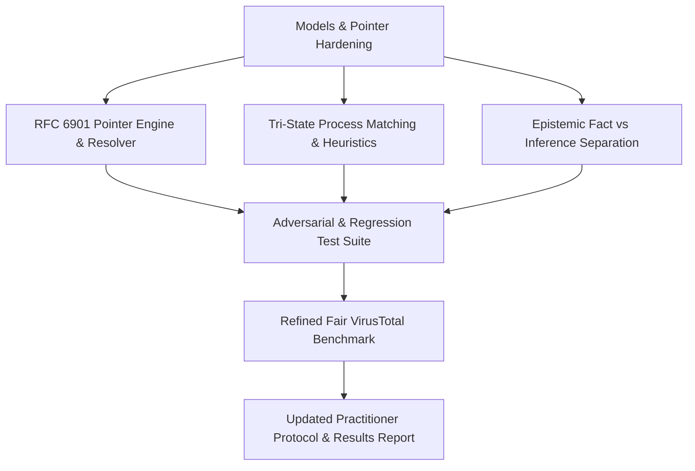

# Milestone 2 Implementation Plan: Hardening & Validation

## Objective
Address the critical feedback on Milestone 1 by:
1. Upgrading evidence pointers to strict RFC 6901 JSON Pointer syntax (`/path/to/0`) with bidirectional resolution verification.
2. Replacing depth-only process matching with a tri-state matcher (`MATCHED`, `POSSIBLE_MATCH`, `UNRESOLVED`) resilient to duplicates, renamed binaries, and missing intermediate nodes.
3. Separating raw observation status (`NOT_OBSERVED`) from causal inferences (`POSSIBLE_COLLECTION_LIMITATION` vs. `CONFIRMED_COLLECTION_FAILURE`), including negative attribution tests.
4. Refining the VirusTotal competitive benchmark to fairly assess individual behavior reports alongside the merged summary, measuring exact manual analyst friction.
5. Updating the practitioner interview kit with the 5-point multidimensional decision gate (Frequency, Cost, Alternatives, Technical Value, Adoption Evidence).

---

## Technical Work Breakdown

### Phase 1: Models & RFC 6901 Compliance
- Update `EvidencePointer` to store RFC 6901 syntax: `/behavior/dropped/0`, escaping `~` as `~0` and `/` as `~1`.
- Implement `resolve_json_pointer(doc, pointer)` in `engine/provenance.py` and verify bidirectional lookup.
- Update `EpistemicStatus` enum:
  - `MATCHED_IN_BOTH_REPORTS`
  - `NOT_OBSERVED_IN_REPORT` (Telemetry fact)
  - `POSSIBLE_COLLECTION_LIMITATION` (Plausible hypothesis)
  - `CONFIRMED_COLLECTION_FAILURE` (Direct evidence of blockage or hook crash)
  - `EVIDENCE_UNAVAILABLE_IN_SOURCE`

### Phase 2: Process Matching Hardening (Tri-State Matcher)
- Implement multi-factor scoring:
  - Image name equality or alias equivalence.
  - Ancestor lineage set similarity (Dice/Jaccard coefficient).
  - Command-line argument token overlap.
  - Sibling/child context.
- Statuses:
  - `MATCHED` (Score >= 0.85, unambiguous)
  - `POSSIBLE_MATCH` (Score 0.50 <= s < 0.85, or multiple candidates)
  - `UNRESOLVED` (Score < 0.50, or contradictory lineage)
- Add adversarial fixtures:
  - Multiple `powershell.exe` instances executing different payloads.
  - Missing intermediate `cmd.exe` process node (direct spawn vs wrapper spawn).
  - Renamed binary executing identical arguments.

### Phase 3: Epistemic Causal Separation & Negative Tests
- Distinguish:
  - A generic timeout/warning -> `POSSIBLE_COLLECTION_LIMITATION`.
  - A specific firewall drop log naming the socket or hook exception -> `CONFIRMED_COLLECTION_FAILURE`.
  - An irrelevant warning (e.g. egress port 8080 warning when missing event is DNS port 53) -> remains `NOT_OBSERVED_IN_REPORT` without false attribution.

### Phase 4: Fair VirusTotal Benchmark & Schema Precision
- Label schemas precisely: `CAPE Sandbox v2.5 JSON` and `Falcon Sandbox Cloud v7.1 JSON`.
- Distinguish VirusTotal's:
  - Individual behavior reports (which contain dropped file hashes and process trees, but are siloed in separate tabs).
  - Merged behavior summary (which flattens lists and loses lineage/attribution).
- Document the exact manual steps an analyst currently performs when using VT across two sandbox engines.

### Phase 5: Verification & Updated Reports
- Run extended test suite with adversarial cases.
- Update `RESULT_REPORT.md` and `INTERVIEW_PROTOCOL.md`.
