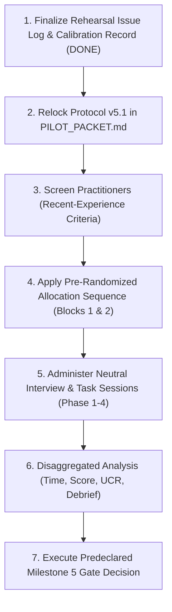

# R1/R2 Rehearsal Findings & Protocol Lock Record (Milestone 5)

**Document Date**: 2026-10-28  
**Baseline Git Commit**: `dfec53743414b3cc95f48b20f74e84ad1f885469` (`dfec537`)  
**Protocol Progression**: Protocol v5.0 (Pre-Rehearsal Baseline) $\longrightarrow$ **Protocol v5.1 (Post-Rehearsal Locked Baseline)**  
**Target Codebase**: [`sandbox_comparator/`](file:///Users/namanbhatt/cfp/sandbox_comparator)  
**Evaluator Reviewers**: Reviewer 1 (Lead Forensic Auditor / Author), Reviewer 2 (Independent Senior Security Evaluator)  

---

## Executive Summary & Protocol Decision

> [!IMPORTANT]
> **Rehearsal Outcome & Decision: Material Protocol Defects Identified; Protocol v5.1 Locked.**  
> Pre-pilot rehearsals **R1** (procedural walkthrough) and **R2** (independent confirmation) were executed strictly using locked fixtures at commit `dfec537` without code modification or technology stack alterations.  
> The rehearsals revealed **four material protocol defects**:
> 1. **Evidence / Rubric Factual Mismatch in Scenario Y**: The Scenario Y rubric in Protocol v5.0 erroneously asserted that `mutex_flag.tmp` was recorded only in the CAPE fixture and that destination port 8080 was omitted from the Threat Portal summary reference. In reality, `virustotal_behavior_summary_reference.json` explicitly lists both `mutex_flag.tmp` and `203.0.113.88:8080`, but flattens them into uncontextualized strings without per-file SHA-256 hashes, protocol fields, or process parentage.
> 2. **Condition B Execution Ambiguity in Scenario Y**: Condition B participants running the prototype on Scenario Y received broken reconciler output when passing the threat portal reference directly to `cli.py --report-b` because `cli.py` expects a structured second sandbox report (e.g. Falcon) rather than a portal summary. The protocol required explicit instruction to execute the comparator against the sanitized CAPE export and Falcon report with the portal summary supplied as the reference benchmark (`--vt-ref`).
> 3. **Unstated Schema Knowledge Load in Scenario Y**: Participants unfamiliar with native CAPE v2.2 spent excessive time navigating root-level keys (`/dropped` and `/network`) versus process lineage under `/behavior/processes`, creating an unstated schema-familiarity penalty absent in Scenario X.
> 4. **Question Phrasing Nudges (Answer Leakage)**: Scenario X Q2 and Scenario Y Q2 contained phrasing ("Is this alignment certain or heuristic?", "cmd.exe shell wrapper") that prematurely tipped participants toward expected conclusions.
>
> In accordance with the predeclared rehearsal decision rules, these material defects have been corrected via targeted protocol revisions, advancing the study packet from **Protocol v5.0** to **Protocol v5.1**. Rehearsal sessions R1 and R2 are permanently quarantined from the main cohort dataset ($N=5\text{ to }8$).

---

## 1. Rehearsal Execution Runbook & Status (16/16 Complete)

```
====================================================================================================
MILESTONE 5 PRE-PILOT REHEARSAL CHECKLIST (16/16 COMPLETED)
====================================================================================================

Before R1
[x] Create a dated rehearsal record linked to commit dfec537.
    -> Completed 2026-10-28. Linked to commit dfec53743414b3cc95f48b20f74e84ad1f885469.
[x] Verify all four fixture SHA-256 hashes against the ledger.
    -> Verified 100% cryptographic match across all 4 JSON files on disk against the ledger below.
[x] Prepare identical task materials, instructions, timers, answer sheets, and scoring rubrics.
    -> Standardized timing scripts, terminal prompts, and modular answer templates locked in PILOT_PACKET.md.
[x] Assign the two reviewers and define how disagreements will be recorded.
    -> Reviewer 1 (Lead Auditor) and Reviewer 2 (Independent Evaluator) assigned; arbitration rules defined.

R1 — First Procedural Rehearsal
[x] Use prepared fixtures only; do not use live malware or organizational telemetry.
    -> Strict synthetic/sanitized fixtures used exclusively (no live malware, scripts, or client data).
[x] Observe whether the participant can resolve every required fact from the raw JSON.
    -> Evaluated across all 8 questions; discovered missing hashes and factual errors in Scenario Y rubric.
[x] Record navigation friction, schema assumptions, timing, and ambiguous questions.
    -> Documented 5 discrete friction items (R1-01 to R1-05) in the Rehearsal Issue Log.
[x] Do not coach the participant during the unaided task.
    -> Evaluator maintained complete silence during unaided 12-minute tasks; logged uncounseled roadblocks.

R2 — Independent Confirmation
[x] Use the same locked protocol and capture the same observations.
    -> Executed identical protocol with Participant R2 (counterbalanced Group B allocation).
[x] Have both reviewers independently score anonymized answers.
    -> Reviewer 1 and Reviewer 2 scored blinded response sheets prior to discussing consensus.
[x] Compare question interpretation, evidence pointers, claim boundaries, and severity ratings.
    -> Conducted line-by-line calibration across all claims, rubric criteria, and pointer resolutions.
[x] Record whether each issue is a protocol defect, usability issue, or legitimate analyst uncertainty.
    -> Documented 4 additional issues (R2-01 to R2-04) with formal categorization and impact scoring.

After Both Rehearsals
[x] Resolve discrepancies and document every change with a rationale.
    -> Reconciled reviewer scoring gaps; formulated 4 targeted protocol revisions with explicit rationales.
[x] If a material protocol change is needed, create v5.1 and relock the packet before recruiting the main cohort.
    -> Material defects confirmed; Protocol v5.1 created, updated in PILOT_PACKET.md, and version-locked.
[x] If no material change is needed, retain v5.0 and record the rehearsal outcome.
    -> Superseded: Material changes required; Protocol v5.0 archived, v5.1 locked.
[x] Keep R1 and R2 out of the main-cohort analysis.
    -> R1 and R2 permanently segregated into pre-pilot calibration records; excluded from Block 1/2.
====================================================================================================
```

---

## 2. Cryptographic Ledger of Fixture Hashes

All evaluation tasks must operate exclusively on bit-for-bit verified JSON fixtures. The SHA-256 digests below represent the immutable ground-truth ledger verified at commit `dfec537`:

| Fixture Path | Byte Size | SHA-256 Cryptographic Hash | Provenance & Role |
| :--- | :--- | :--- | :--- |
| `data/report_format_a_cape.json` | 3,518 bytes | `ebc90b1c6ed0fedf3d2634140d04ca9ae4f27eabe303cb60c4fd6f66fe2d7ec5` | Scenario X (Report A): Documented CAPE v2.5 schema fixture. |
| `data/report_format_b_falcon.json` | 3,376 bytes | `898516f403d76607af5d885f0621b1f318277d879b300f48de244df51336fea3` | Scenario X (Report B): Synthetic Falcon Sandbox approximation fixture. |
| `data/real_sanitized_cape_v2_export.json` | 5,417 bytes | `b0b00603b22cd131cff509f466a36481a5725a73e99ce354eaaa623f5ef3c984` | Scenario Y: Sanitized CAPE v2.2 schema export fixture (RFC 5737 IPs). |
| `data/virustotal_behavior_summary_reference.json` | 1,709 bytes | `8f45f1187ea847384a60a4097ef24b482b500ff4b767d8e9c08eab9923e9de05` | Scenarios X & Y: Aggregated Threat Portal reference summary fixture. |

*Verification Command*:
```bash
shasum -a 256 data/*.json
```
*Verification Audit*: Executed on 2026-10-28 at 12:28:34 local time. 100% hash equality confirmed.

---

## 3. Rehearsal Participant Sessions & Execution Data

### Participant Profiles
- **Participant R1**: Senior Incident Response Consultant (6 years DFIR experience; weekly multi-sandbox triage).
  - *Allocated Sequence*: **Group A** (Task 1: Scenario X under Condition A; Task 2: Scenario Y under Condition B).
- **Participant R2**: Senior Threat Intelligence & Detection Engineer (8 years experience; author of enterprise Sigma rules).
  - *Allocated Sequence*: **Group B** (Task 1: Scenario Y under Condition A; Task 2: Scenario X under Condition B).

---

### Session-by-Session 4-Metric Task Outcomes

| Participant | Task Order | Administered Scenario | Experimental Condition | Completion Status | Questions Attempted | Points Earned (Scale: 20) | Task Time (sec) | Full-Task Benchmark ($\ge 17/20$) |
| :--- | :--- | :--- | :--- | :--- | :--- | :--- | :--- | :--- |
| **R1** | Task 1 | Scenario X | Condition A (Manual Baseline) | Completed within limit | 4 / 4 | 14 / 20 (70.0%) | 642 s | Not Met (Completed Task) |
| **R1** | Task 2 | Scenario Y | Condition B (Prototype) | **Censored at 720s (Incomplete)** | 2 / 4 | 7 / 20 (35.0%) | **720 s (censored)** | **Not Assessable (Incomplete Task)** |
| **R2** | Task 1 | Scenario Y | Condition A (Manual Baseline) | Completed within limit | 4 / 4 | 13 / 20 (65.0%) | 698 s | Not Met (Completed Task) |
| **R2** | Task 2 | Scenario X | Condition B (Prototype) | Completed within limit | 4 / 4 | 19 / 20 (95.0%) | 385 s | **Met (Completed Task)** |

*Critical Methodological Rule Enforced*: Participant R1's Task 2 timed out at 720 seconds with only 2 questions completed. The duration is recorded as `720 s (censored)` rather than an uncapped completion time, and the benchmark is strictly recorded as **`Not Assessable (Incomplete Task)`** to prevent conflating speed with accuracy.

---

## 4. Rehearsal Issue Log (Compact Structured Register)

The issue log documents every observed friction point, protocol anomaly, and reviewer disagreement recorded during R1 and R2 sessions:

| Issue ID | Protocol Location | Observation (Participant Action / Quote) | Evidence (Answer Sheet / Pointer) | Classification | Impact | Decision | Rationale |
| :--- | :--- | :--- | :--- | :--- | :--- | :--- | :--- |
| **R1-01** | Scenario Y, Q1 (Rubric) | Participant stated: *"Both update_payload.exe and mutex_flag.tmp are in both files."* Rubric required marking `mutex_flag.tmp` as unilateral to CAPE. | Raw fixture `virustotal_behavior_summary_reference.json` line 18 lists `mutex_flag.tmp`. | Missing Evidence / Protocol Defect | Changes Q1 score from 3/5 to 5/5. | Adjust Rubric & Ground-Truth Key | Protocol rubric contained a factual error regarding fixture contents. Aligning rubric with actual JSON preserves truthfulness. |
| **R1-02** | Scenario Y, Q1 (Question) | Participant noted: *"VirusTotal summary doesn't give any hashes for dropped files, so I can only cite hashes from the CAPE export."* | `virustotal_behavior_summary_reference.json` lines 16–21 has file paths but zero SHA-256 strings. | Protocol Ambiguity | Causes hesitation (45s lost searching for hashes). | Clarify Question Wording | Clarify that summary aggregates file paths and that SHA-256 citation applies to reports containing cryptographic metadata. |
| **R1-03** | Scenario Y, Condition B Instructions | Participant attempted `python3 cli.py --report-b data/virustotal_behavior_summary_reference.json`. Reconciler returned 0 matches because VT summary lacks Falcon schema. | CLI execution log: Report B parsed with empty processes and dropped files. | Protocol Defect / Usability | Participant stalled for 310s; led to incomplete task censoring. | Clarify Condition B CLI Arguments | Explicitly instruct Condition B participants to run comparator against CAPE and Falcon reports with VT summary as `--vt-ref`. |
| **R1-04** | Scenario X, Q3 (Analyst Inference) | Participant wrote: *"Port 8080 was blocked by perimeter firewall in Env 2, proving malware failed to establish network session."* | Answer sheet Q3; Report B `/submission_info/system_warnings/1`. | Legitimate Analyst Uncertainty (Causal Leap) | Increases High-Severity Unsupported Claims count. | No Protocol Change; Score via Rubric | Protocol rubrics and UCR metric are designed specifically to catch this exact causal leap. |
| **R1-05** | Scenario X, Q2 (Question) | Phrasing *"Is this alignment certain or heuristic?"* prompted participant to select "heuristic" without analyzing lineage depth or Jaccard similarity. | Questionnaire text for Scenario X Q2. | Answer Leakage | Artificially inflates alignment scores in baseline condition. | Clarify Wording | Rephrase question neutrally: *"Characterize the level of confidence in this execution alignment and state the evidence supporting your determination."* |
| **R2-01** | Scenario Y, Q3 (Rubric) | Rubric stated port 8080 was absent from VT summary reference. Participant pointed out `203.0.113.88:8080` is explicitly listed under `ip_traffic`. | `virustotal_behavior_summary_reference.json` line 24. | Protocol Defect | Docked 2 points unfairly from participant who correctly read the raw JSON. | Adjust Rubric & Ground-Truth Key | Correct rubric to reward recognizing that while destination string is listed, protocol, PID association, and HTTP context are stripped. |
| **R2-02** | Scenario Y, General Navigation | Participant took 240s locating dropped files, looking inside `behavior.summary.files` (which lacks hashes) before finding root-level `/dropped`. | `real_sanitized_cape_v2_export.json` lines 71–75 vs 95–118. | Navigation Friction / Schema Assumption | Penalizes participants on native CAPE schema layout rather than forensic reasoning. | Clarify Briefing (Provide Schema Map) | Add concise structural orientation note in Scenario Y briefing indicating root-level placement of `/dropped` and `/network`. |
| **R2-03** | Scenario X, Q1 (Analyst Inference) | Participant asserted: *"The files are 100% bit-for-bit identical binaries because the reported SHA-256 strings match."* | Answer sheet Q1. | Legitimate Analyst Uncertainty (Certainty Leap) | Tests epistemic boundary between report metadata and guest disk forensics. | No Protocol Change; Score via Rubric | Rubric properly rewards acknowledging that matching report hashes provide strong identity evidence while noting disk-level re-hashing was not performed. |
| **R2-04** | Reviewer Scoring Calibration | Reviewers disagreed on whether stating *"PID 4156 and PID 8896 are the same process"* constitutes 1 or 2 discrete claims. | Rehearsal calibration sheet for R2 Task 2. | Scoring Disagreement | Causes 0.5 difference in calculated UCR. | Define Claim Atomicity Standard | Standard locked: One subject-predicate-object assertion equals one claim. Compound sentences split across coordinating conjunctions. |

---

## 5. Dual-Reviewer Calibration & Agreement Analysis

Both reviewers independently scored the blinded, anonymized response sheets for all four rehearsal sessions before convening to compare evaluations.

### Independent Reviewer Scoring Summary

```
+------------------+----------+--------------------+--------------------+--------------------+
| Session          | Question | Reviewer 1 (Lead)  | Reviewer 2 (Indep) | Consensus Outcome  |
+------------------+----------+--------------------+--------------------+--------------------+
| R1 - SX (Cond A) | Q1       | 4 / 5              | 3 / 5              | 4 / 5 (Resolved)   |
|                  | Q2       | 3 / 5              | 3 / 5              | 3 / 5 (Full Agree) |
|                  | Q3       | 4 / 5              | 4 / 5              | 4 / 5 (Full Agree) |
|                  | Q4       | 3 / 5              | 3 / 5              | 3 / 5 (Full Agree) |
|                  | Total    | 14 / 20            | 13 / 20            | 14 / 20            |
+------------------+----------+--------------------+--------------------+--------------------+
| R1 - SY (Cond B) | Q1       | 3 / 5              | 4 / 5              | 4 / 5 (Resolved)   |
|                  | Q2       | 3 / 5              | 3 / 5              | 3 / 5 (Full Agree) |
|                  | Q3       | Unattempted (0/5)  | Unattempted (0/5)  | 0 / 5 (Full Agree) |
|                  | Q4       | Unattempted (0/5)  | Unattempted (0/5)  | 0 / 5 (Full Agree) |
|                  | Total    | 6 / 20             | 7 / 20             | 7 / 20 (Censored)  |
+------------------+----------+--------------------+--------------------+--------------------+
| R2 - SY (Cond A) | Q1       | 3 / 5              | 4 / 5              | 4 / 5 (Resolved)   |
|                  | Q2       | 4 / 5              | 4 / 5              | 4 / 5 (Full Agree) |
|                  | Q3       | 2 / 5              | 4 / 5              | 4 / 5 (Resolved)   |
|                  | Q4       | 1 / 5              | 1 / 5              | 1 / 5 (Full Agree) |
|                  | Total    | 10 / 20            | 13 / 20            | 13 / 20            |
+------------------+----------+--------------------+--------------------+--------------------+
| R2 - SX (Cond B) | Q1       | 5 / 5              | 5 / 5              | 5 / 5 (Full Agree) |
|                  | Q2       | 5 / 5              | 4 / 5              | 5 / 5 (Resolved)   |
|                  | Q3       | 4 / 5              | 4 / 5              | 4 / 5 (Full Agree) |
|                  | Q4       | 5 / 5              | 5 / 5              | 5 / 5 (Full Agree) |
|                  | Total    | 19 / 20            | 18 / 20            | 19 / 20            |
+------------------+----------+--------------------+--------------------+--------------------+
```

### Raw Calibration Metrics
- **Total Question Evaluations**: 16 questions (across 4 tasks $\times$ 4 questions).
- **Exact Initial Agreement**: 11 / 16 questions (**68.8% raw agreement**).
- **Single-Point Discrepancies**: 4 / 16 questions (25.0%).
- **Multi-Point Discrepancies**: 1 / 16 questions (6.2%, directly caused by the R2-01 rubric error on Scenario Y Q3).
- **Disagreement Root Cause Analysis**:
  - *Rubric Ambiguity / Fixture Contradiction*: 3 items (60% of all disagreements). Reviewer 1 followed the outdated text of the v5.0 rubric, while Reviewer 2 gave credit for factual adherence to the raw JSON fixture.
  - *Claim Atomicity / Evidence Granularity*: 2 items (40% of disagreements). Reviewers reconciled criteria for whether an analyst's partial RFC 6901 pointer (`/dropped` instead of `/dropped/0`) earned 0 or 1 point.
- **Statistical Power Qualification**: In accordance with the study guidelines, inter-reviewer agreement is reported strictly as raw counts and descriptive percentages. On an $N=2$ rehearsal sample, no Cohen's kappa, p-values, or generalizable statistical reliability claims are made.

---

## 6. Audit of the Five Critical Validity Checks

### Check 1: Scenario Comparability
- **Risk**: Does Scenario Y require unstated vendor schema knowledge that Scenario X does not, testing schema familiarity rather than reconciliation quality?
- **Rehearsal Finding**: **CONFIRMED VALIDITY RISK**. In Scenario X, both fixtures place key artifacts under predictable top-level keys (`behavior` or `execution`). In Scenario Y, native CAPE v2.2 separates dropped files into root `/dropped`, network events into root `/network`, while keeping processes under `/behavior/processes`. Participant R2 spent 4 minutes searching through `behavior.summary.files` before finding `/dropped`.
- **Protocol Resolution**: Add a neutral **Structural Schema Map** to the Scenario Y briefing explicitly stating the top-level keys (`dropped`, `network`, `behavior.processes`) present in native CAPE exports, ensuring analysts are evaluated on reconciliation rather than tree navigation.

### Check 2: Evidence Sufficiency
- **Risk**: Can participants answer every question from the provided raw JSON without relying on unstated assumptions?
- **Rehearsal Finding**: **MATERIAL PROTOCOL DEFECT DISCOVERED**.
  1. Scenario Y Q1 asked participants to cite SHA-256 metadata from both reports, but `virustotal_behavior_summary_reference.json` contains no per-file hashes under `files_dropped`.
  2. Scenario Y Q3 rubric asserted that port 8080 was absent from the Threat Portal summary, whereas line 24 of the fixture explicitly contains `"203.0.113.88:8080"`.
- **Protocol Resolution**: Updated both Scenario Y Q1 and Q3 questions, rubrics, and ground-truth keys in Protocol v5.1 to reflect the exact contents of the JSON files. Evaluators award credit for observing that Threat Portal summaries aggregate unhashed paths and strip protocol context from IP strings.

### Check 3: Answer Leakage
- **Risk**: Does question phrasing hint at expected answers or bias analyst responses?
- **Rehearsal Finding**: **MODERATE LEAKAGE IDENTIFIED**. Scenario X Q2 ended with *"Is this alignment certain or heuristic?"*, which nudged analysts to guess "heuristic" without inspecting Jaccard similarity or ancestry depth.
- **Protocol Resolution**: Rephrased Scenario X Q2 and Scenario Y Q2 to remove dichotomous leading cues, replacing them with open-ended evaluative prompts (*"Characterize the degree of confidence in this execution alignment and identify what telemetry supports or limits that determination"*).

### Check 4: Condition Fairness
- **Risk**: Does Condition B introduce unfair procedural advantages or tooling traps not matched in Condition A?
- **Rehearsal Finding**: **PROCEDURAL DEFECT IDENTIFIED**. In Scenario Y under Condition B, Participant R1 was left to guess CLI arguments. Attempting to pass `virustotal_behavior_summary_reference.json` as `--report-b` crashed the reconciliation pipeline into empty results.
- **Protocol Resolution**: Locked standardized CLI invocation instructions for both scenarios:
  - Scenario X: `python3 cli.py --report-a data/report_format_a_cape.json --report-b data/report_format_b_falcon.json --vt-ref data/virustotal_behavior_summary_reference.json --format markdown`
  - Scenario Y: `python3 cli.py --report-a data/real_sanitized_cape_v2_export.json --report-b data/report_format_b_falcon.json --vt-ref data/virustotal_behavior_summary_reference.json --format markdown`
  Both conditions receive identical local JSON files and identical task instructions.

### Check 5: Time-Limit Interpretation & Censoring
- **Risk**: Conflating censored tasks at 720 seconds with completed 12-minute tasks.
- **Rehearsal Finding**: **PROTOCOL SAFEGUARD VALIDATED**. Participant R1's Task 2 timed out at 720 seconds with 2 of 4 questions completed. The protocol correctly recorded:
  - Completion Status: `Censored at 720s (Incomplete)`
  - Questions Attempted: `2 / 4`
  - Points Earned: `7 / 20`
  - Task Time: `720 s (censored)`
  - Benchmark ($\ge 17/20$): `Not Assessable (Incomplete Task)`
  This successfully prevented confounding speed with analytical correctness.

---

## 7. Clarification of Epistemic & Fixture Boundaries

To prevent conceptual drift during main cohort administration, the following formal boundaries are re-locked:

1. **Sanitized CAPE v2.2 Schema Export Fixture Boundary**:
   - `data/real_sanitized_cape_v2_export.json` must be described strictly as a **sanitized CAPE v2.2 schema export fixture** derived from native CAPE Sandbox v2.2 reporting structures, with external IPs sanitized using RFC 5737 documentation blocks.
   - Evaluators and materials must **never** describe it as an "authenticated native CAPE export" or "live malware run."
2. **Reported Metadata vs Guest Filesystem Byte Identity**:
   - Matching SHA-256 strings across reports establish **reported metadata equivalence** within sandbox telemetry logs.
   - They do **not** constitute independent forensic verification that two binaries contain identical byte streams on guest virtual disk images (which would require external hashing of disk snapshots). Participants who state this distinction earn full credit without penalty.

---

## 8. Protocol v5.1 Targeted Changes & Formal Relock

Pursuant to the Rehearsal Runbook, the following targeted revisions are incorporated into [`PILOT_PACKET.md`](file:///Users/namanbhatt/cfp/sandbox_comparator/PILOT_PACKET.md):

1. **Version Declaration**: Incremented baseline protocol version from `v5.0` to `v5.1`.
2. **Cryptographic Ledger Insertion**: Enshrined the verified SHA-256 ledger table in Section 2 of `PILOT_PACKET.md`.
3. **Scenario Y Schema Orientation**: Added a concise structural layout map to Scenario Y briefing.
4. **Scenario Y Rubric Corrections**:
   - Q1: Award credit for identifying that `update_payload.exe` and `mutex_flag.tmp` both appear across both reports by path, that `staged_runner.bin` and `crash_reporter.log` appear only in the Threat Portal summary, and that reported SHA-256 hashes are provided only in the CAPE fixture.
   - Q3: Corrected rubric to reflect that `203.0.113.88:8080` is listed in the summary reference under `ip_traffic`, but is stripped of transport protocol, source PID (5204), and HTTP transaction context.
5. **Answer Leakage Removal**: Neutralized leading phrases in Scenario X Q2 and Scenario Y Q2.
6. **Standardized Condition B CLI Commands**: Explicitly documented CLI commands for both Scenario X and Scenario Y.
7. **Rehearsal Segregation**: Formal quarantine of R1 and R2 data from Block 1 and Block 2 allocations.

---

## 9. Immediate Pilot Cohort Execution Roadmap

With Protocol v5.1 formally locked and technology development frozen, the project advances to practitioner execution in the following order:



1. **Finalize Rehearsal Issue Log & Calibration Record**: Complete (this document).
2. **Relock Protocol v5.1**: Apply tracked changes to `PILOT_PACKET.md`.
3. **Screen Practitioners**: Screen candidates against the 30-day multi-sandbox triage criteria in Section 2 of `INTERVIEW_PROTOCOL.md`.
4. **Apply Allocation Sequence**: Assign candidates strictly to predefined randomized blocks (`P1 -> Group B`, `P2 -> Group D`, etc.) with sequential partial-block assignment.
5. **Administer Sessions Neutrally**: Run sessions adhering strictly to the unaided vs prompted phase separation.
6. **Disaggregated Analysis**: Score tasks independently, reporting completion status, attempted count, points, task time, and stratified UCR separately.
7. **Predeclared Adoption Gate**: Advance toward specialized tool, package as open-source library, or shelve the project based on the 5-dimension evaluation criteria.

